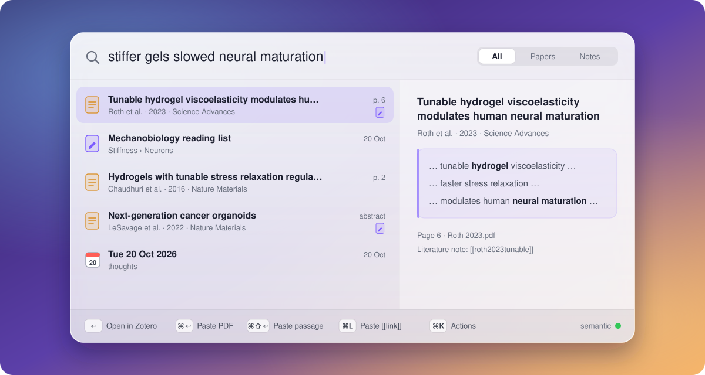
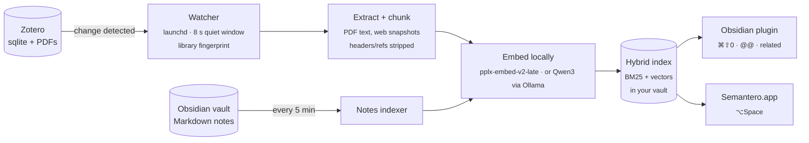

<p align="center">
  
</p>

<p align="center">
  <a href="https://github.com/standard-model-lagrangian/Semantero/actions/workflows/ci.yml"></a>
  
  
  
  
</p>

<p align="center">
  <b>Semantero</b> <i>(semantic + Zotero, a bad shorthand)</i> is a local search layer over your <b>Zotero</b> papers and
  <b>Obsidian</b> notes.<br>Type what a paper <i>said</i>, get the page it said it on, and paste it anywhere.
</p>

---

## Why

You read a paper months ago. You remember roughly what it found, not the title, not the authors, not the folder.
Zotero's search wants the exact words; Finder wants the file name; your notes are somewhere else again. So you dig.

Semantero indexes every PDF and web snapshot in your Zotero library (and, if you want, every note in your vault) into
one **hybrid index**: keyword matching for the exact terms you do remember, plus **embeddings** for the meaning of the
ones you don't. Then it puts that index one keystroke away, in Obsidian and in every other app on your Mac.

- **It finds the passage, not just the paper.** Results open at the matching page.
- **It's fast.** Keyword results land on every keystroke (1.6 ms p95), semantic ones after a short pause (~200 ms).
- **It's private.** Embeddings run on your machine (pplx-embed-v2-late on a pinned llama.cpp, or Qwen3 through
  [Ollama](https://ollama.com)). No accounts, no API keys, no cloud, no subscription. Search works offline.
- **It keeps itself fresh.** Add a paper to Zotero and it is searchable about a minute later. You never re-index.

## What you get

<p align="center">
  
  <br><sub>Illustrative mock-up of the launcher. Papers and their literature notes collapse into one row.</sub>
</p>

| | |
|---|---|
| **⌥Space, in any app** | A floating glass panel searches papers *and* notes. `↵` opens the PDF in Zotero at the page, `⌘↵` pastes the **PDF itself** into Mail, Teams or an LLM chat, `⌘⇧↵` pastes the passage with its citation, `⌘L` pastes the `[[wikilink]]`, `⌘K` shows every action. Rows drag out as files. |
| **`⌘⇧0` in Obsidian** | The same search inside your vault. `⌘↵` inserts `[[citekey]]` and creates the literature note from your template. |
| **`@@` inline citations** | Type `@@` anywhere in prose for a citation autocomplete. One undo step, never fires inside code, math or frontmatter. |
| **Related papers panel** | Reads the section you're writing and suggests papers from your library that you haven't cited yet. |

> [!TIP]
> Live mostly in Zotero? It still earns its keep. The vault can be nearly empty: ⌥Space alone gives you semantic search
> over every PDF you own, from anywhere.

## How it works



1. **Watch.** A tiny `launchd` job notices when Zotero's database changes, waits for it to go quiet, and compares a
   fingerprint of the library. Nothing changed means nothing is rebuilt.
2. **Extract.** New PDFs and web snapshots become clean text (running headers, footers and reference lists stripped),
   split into chunks that remember their page.
3. **Embed.** Each chunk gets vectors from a small local model. If the model isn't running, the index stays
   keyword-only and catches up later instead of failing.
4. **Rank.** A query runs through **BM25** (with prefix matching, so half-typed words work) and **dense similarity** at
   the same time; **Reciprocal Rank Fusion** merges the two lists, so exact terms and vague concepts both rise to the top.
5. **Serve.** The index is written atomically into `.planner/` in your vault. The Obsidian plugin and the macOS app
   hot-swap it in memory without interrupting you.

<details>
<summary><b>Under the hood: numbers and design choices</b></summary>

<br>

| | Measured |
|---|---|
| Keyword search per keystroke, real library, in the app | **1.6 ms** p95 |
| Hybrid scoring + merge, real library | **~8 ms** p95 |
| Query embedding (Qwen3 0.6B, Ollama warm) | **~190 ms** |
| BM25 prefix search on a 3× synthetic library (25k chunks) | **1.5 ms** p95 |
| App memory at rest | **~112 MB** |

- One ranking core in TypeScript is shared by the Obsidian plugin and the macOS app (run there in JavaScriptCore, with
  the vector pass in Apple's Accelerate). A shared conformance suite keeps every ranker returning the same results.
- The menu-bar app is a non-activating panel: the app you were typing in stays frontmost, which is what makes "paste
  the PDF into this chat" work.
- Embedding models are switchable profiles, one index each, so you can compare them on your own library before
  committing.
- Every budget, measurement and trade-off is in [docs/DECISIONS_AND_GAPS.md](docs/DECISIONS_AND_GAPS.md).

</details>

## Quick start

You need a Mac, **[Zotero](https://www.zotero.org/)** with the **[Better BibTeX](https://retorque.re/zotero-better-bibtex/)**
plugin (for citekeys), **[Obsidian](https://obsidian.md/)** with a vault, and **[Homebrew](https://brew.sh/)**.
The setup script installs the default embedding model, **pplx-embed-v2-late** (a one-off ~550 MB download,
then about an hour per 9,000 paper texts for the first index). For a lighter install, `--model qwen` uses
Qwen3-Embedding 0.6B through [Ollama](https://ollama.com) instead (~600 MB). Compare them on your own library:
[docs/EMBED_INSTALLS.md](docs/EMBED_INSTALLS.md).

```bash
git clone https://github.com/standard-model-lagrangian/Semantero.git
cd Semantero
./setup-search.sh            # add --vault "/path/to/Vault" --zotero "/path/to/Zotero" if they're not in the default places
                             # add --model qwen for the lighter Ollama model
```

Then in Obsidian: **Settings → Community plugins → reload → enable "Semantero"**, and press `⌘⇧0`.

The script sets up Python, poppler and the embedding model, installs the plugin, builds your first index and starts the
background watcher. Custom paths go to a git-ignored `config.local.toml`, so `git pull` never conflicts.

### Pick your setup

| **Obsidian only** (~5 min) | **Global** (~10 min) |
|---|---|
| `⌘⇧0` search, `@@` citations, literature notes, related papers, all inside Obsidian | All of that, **plus** your notes indexed and **⌥Space in every app** |
| The quick start above. No Xcode, no Node | Quick start, then `[notes] enabled = true` in `config.local.toml` and `make install-global`. Needs macOS 26, Node and Apple's free Command Line Tools ([is Xcode needed?](docs/INSTALL.md#do-i-need-xcode)) |

Step by step for both, switching between them, and uninstalling: **[docs/INSTALL.md](docs/INSTALL.md#choose-your-setup)**.

<details>
<summary><b>Managing the background watcher</b></summary>

<br>

| Command | What it does |
|---|---|
| `./setup-search.sh status` | Embedding model, Python, index and watcher health (and whether the index is keyword-only) |
| `./setup-search.sh index` | Update or rebuild the index now |
| `./setup-search.sh logs` | Last 40 lines of the watcher log |
| `./setup-search.sh watch` | Run the watcher in the foreground |
| `./setup-search.sh stop` / `start` | Unload / load the watcher in `launchd` |
| `.venv/bin/python -m planner doctor --search` | Search-specific health checks, with fixes |

</details>

## Repository layout

```
setup-search.sh       one-command installer and watcher manager
planner/              Python: Zotero extraction, PDF/snapshot chunking, embeddings, BM25, watcher, notes index, planner
obsidian/paper-search Obsidian plugin (TypeScript); its src/ holds the shared ranking core
launcher-core/        ranking + view models for the app, bundled to dist/ranker.js and run in JavaScriptCore
macos/                Semantero.app (SwiftPM, no dependencies)
launchd/              the background jobs
docs/                 install guide, development guide, design specs, decisions log
```

## Contributing

Read [AGENTS.md](AGENTS.md) first: layout, commands, and the rules that keep a real vault safe. Then:

```bash
make dev-setup   # once, on a fresh clone
make check       # ruff, tsc, Python + plugin + launcher-core + Swift tests, stale-bundle check
```

Changes are test-first, and tests never touch a real vault, Zotero library or Ollama. The full guide is
[docs/DEVELOPMENT.md](docs/DEVELOPMENT.md); every doc is indexed in [docs/README.md](docs/README.md).

MIT licensed: see [LICENSE](LICENSE).

<p align="center"><sub>Built to stop digging through Finder for that one paper.</sub></p>
